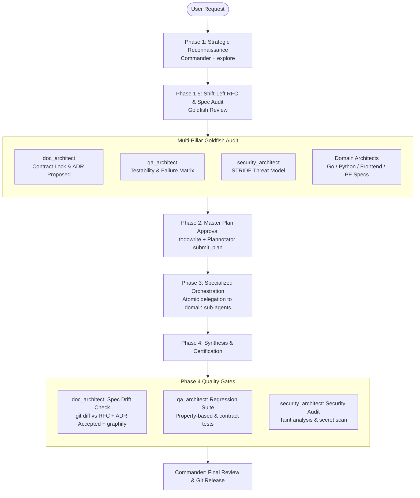

# OpenCode Agent Engineering Guide

> **WARNING:** DO NOT EDIT FILES IN `.config/opencode/agent/` DIRECTLY.
> They are generated artifacts. Your changes will be overwritten.
> Edit templates in `.config/opencode/builder/templates/` instead.

## 🏗 Architecture

This repository uses a **GitOps-style Builder Pattern** to generate AI Agent configurations. It also contains platform tools and dotfiles.

```text
.config/opencode/
├── bin/                      # CLI Tools
│   └── oc                    # OpenCode builder + launcher wrapper (symlinked to ~/.local/bin/oc)
├── builder/                  # The Build System (Go)
│   ├── main.go               # The Compiler — compiles templates → agents + config
│   ├── current_profile       # Persistent profile choice (user-managed)
│   ├── README.md             # Builder documentation
│   └── templates/            # SOURCE OF TRUTH
│       ├── agent/            # Agent templates (YAML frontmatter + {file:} includes)
│       │   ├── commander.md
│       │   ├── PE.md
│       │   ├── go_architect.md
│       │   ├── python_architect.md
│       │   ├── frontend_architect.md
│       │   ├── qa_architect.md
│       │   ├── security_architect.md
│       │   └── doc_architect.md
│       ├── config/
│       │   └── config.json   # Config template (${VAR} substitution + _requires_env)
│       └── model_profiles.json # Model profiles (opencodego — sole profile since 2026-11-15; MIXED roster: 8 technical agents on opencode-go, 7 personal on native google: 3× gemini-4-hydrogen + 4× gemini-3.8-flash)
├── prompts/                 # Reusable Behavior Libraries (included via {file:})
│   ├── behavior.md           # Shared behavioral rules (never be a yes-man, wait for user)
│   ├── commander_behavior.md # Commander-specific orchestration protocol
│   ├── commander_identity.md # Commander persona
│   ├── pe_behavior.md        # PE operating protocol
│   ├── pe_identity.md        # PE persona
│   ├── specialist_identity.md # Shared identity for all sub-agents
│   ├── frontend_behavior.md  # Frontend architect protocol
│   ├── go_architect_behavior.md # Go architect specific behavior
│   ├── python_architect_behavior.md # Python architect specific behavior
│   ├── qa_behavior.md        # QA SDET protocol
│   ├── security_behavior.md # Security architect protocol
│   ├── doc_behavior.md       # Documentation architect protocol
│   ├── caveman_behavior.md   # Token-saving protocol for sub-agents
│   ├── engram_memory.md      # Engram Ask-First memory protocol
│   ├── glossary.md           # Architecture glossary (Clean Arch, Hexagonal, etc.)
│   ├── _installed_capabilities.md # List of installed plugins/MCPs/skills
│   ├── _subagent_permissions.md   # Centralized subagent permission rules
│   ├── language.md           # Language detection (Spanish ↔ English)
│   ├── language_subagent.md  # Language rules for sub-agents
│   ├── lean_technical_behavior.md # Concise communication rules
│   ├── subagent_behavior.md  # Sub-agent integrity rules
│   └── tools_rules.md        # Preferred CLI tools (bat, rg, fd, etc.)
├── agent/                    # ⚠️ GENERATED OUTPUT (Do not edit — run builder)
├── tool/                     # Platform Tools (TS/Bun & Go)
│   ├── hex_check.go         # Hexagonal architecture validator (Go)
│   ├── hexagonal-validator.ts # OpenCode tool wrapper for hex_check.go
│   ├── k8s-pod-doctor.ts    # Kubernetes pod diagnostic tool
│   ├── mgrep.ts              # Semantic search tool (MxBai API)
│   ├── tofu-scan.ts          # Trivy-based IaC security scanner
│   └── graphify.sh           # Graphify wrapper (ensures PATH)
├── skill/                   # OpenCode Skills (loaded on-demand)
│   ├── hexagonal-architect/  # Go hexagonal architecture enforcement
│   ├── infra-security-check/ # Trivy security scanning skill
│   └── production-log-analyzer/ # Datadog log analysis skill
├── command/                  # Custom slash commands
│   ├── infra-scan.md         # Security & infra scan (uses PE agent)
│   └── k8s-doctor.md         # K8s pod diagnostics (uses PE agent)
├── plugins/                  # Local V2 plugins — AUTO-DISCOVERED, never listed in config array
│   ├── engram.ts              # Engram session tracking + compaction hooks
│   ├── squeez.js              # Output compression (95% token reduction)
│   ├── graphify.js            # Knowledge graph reminders (shell tool hook)
│   ├── run-watch.ts           # Tool `run_watch` — bg script + session wake (detached survives restarts)
│   ├── yt-transcript.ts       # Tool `yt_transcript` — YouTube transcripts via yt-dlp (no paid API)
│   └── echo.ts.v1-retired     # Retired V1 clone (non-.ts extension = ignored by auto-discovery)
├── squeez/                   # Squeez configuration
│   └── config.ini             # Compression settings (persona: ultra)
├── opencode.json             # ⚠️ GENERATED (secrets injected — gitignored)
├── cli.json                  # V2 terminal config (theme, terminal plugins — currently plugins: [])
└── tui.json                  # ⚠️ V1 relic — auto-migrated to cli.json; candidate for deletion
```

## 🛠 Build System

### How It Works

1. **Agent Templates** (`.md` files) contain YAML frontmatter + `{file:prompts/...}` include directives.
2. **Model Profiles** (`model_profiles.json`) define which model each agent uses. Templates reference models via `{{MODEL:key}}` placeholders.
3. The **Go Builder** (`main.go`) reads all agent templates, resolves `{file:}` includes and `{{MODEL:xxx}}` placeholders, and writes the compiled output to `agent/`.
4. The **Config Template** (`config.json`) uses `${ENV_VAR}` substitution, `{{MODEL:xxx}}` resolution, and `_requires_env` arrays. If a required env var is missing, the entire MCP entry is removed from the output.

### Building

**Recommended: Use the `oc` wrapper** (symlinked to `~/.local/bin/oc`):

```bash
# Launch opencode (auto-rebuilds if config is stale)
oc

# Rebuild with specific profile, then launch (opencodego is the only profile today)
oc --profile opencodego

# Set persistent default profile (no launch)
oc --set-current opencodego

# Force rebuild without launching
oc --rebuild

# Sync agents + notes to homesrv (Raspberry Pi 4) & restart opencode.service
oc --sync
oc --sync --dry-run      # Preview without touching the server
oc --sync --agents-only  # Sync only compiled agent definitions
oc --sync --notes-only   # Sync only context notes (~/notas/)

# List available profiles
oc --list-profiles
```

**Manual build** (if you need fine-grained control):

```bash
# 1. Export secrets (only the ones you have)
export BRAVE_API_KEY='...'

# 2. Run the builder (uses builder/current_profile, else default_profile in model_profiles.json = opencodego)
cd .config/opencode/builder && go run main.go

# Or override with env var
MODEL_PROFILE=opencodego go run main.go
```

**Profile Resolution Priority:**
1. `MODEL_PROFILE` env var (temporary override)
2. `builder/current_profile` file (persistent choice — currently `opencodego`)
3. `default_profile` in `model_profiles.json` — now `opencodego` (was `google` until 2026-11-15)
4. Hardcoded fallback: `opencodego`

Selecting a removed profile (`google`, `gemini`) aborts in the `oc` wrapper: `Profile '<name>' not found.
Available: opencodego`. Only `opencodego` exists.

The builder will:
- Load the active model profile from `model_profiles.json`
- Compile all agent templates → `agent/*.md`
- Resolve `{{MODEL:xxx}}` placeholders with profile values
- Generate `opencode.json` with env vars substituted
- Remove MCP entries with missing required env vars
- Log ✅/🚫 for each MCP entry's status

### Model Profiles

Models are **not hardcoded** in agent templates. Instead, each profile in `model_profiles.json` defines the full roster. Since 2026-11-15 there is **one profile only** — `google` and `gemini` were deleted (see **Model Providers**). The single profile is **mixed** since 2026-11-15: technical agents on the gateway, personal agents on a native Google API key, and within that roster the personal keys are **split across two Google tiers** (initially all 7 on hydrogen, rebalanced the same day on measured cost):

| Profile | Commander | Workers | Personal agents | small_model |
|---------|-----------|---------|-----------------|-------------|
| `opencodego` ★ **DEFAULT** | opencode-go/qwen3.8-flash | opencode-go/qwen3.8-flash | **google/gemini-4-hydrogen** ×3 — `finanzas`, `life`, `coach` (sensitive/reflective) · **google/gemini-3.8-flash** ×4 — `barista`, `chef`, `organiza`, `habitos` (factual/short-turn) | opencode-go/qwen3.8-flash |

> **Cost / quota note (mixed profile, rebalanced 2026-11-15; billing state updated same day):** the
> 10 gateway keys (commander, PE, the six architects, `model`, `small_model`) resolve through
> `opencode-go`. The 7 personal keys resolve through the **native `google` provider with
> `GEMINI_API_KEY`** (AI Studio API) — so personal-agent chatter burns **billed API usage**, not a
> subscription. Nothing depends on an active Google AI Pro subscription, and **AI Pro would not raise
> these API quotas even if it existed**: Gemini API tiers are driven by accumulated spend history on
> the GCP account, not by consumer subscriptions (docs:
> [billing](https://ai.google.dev/gemini-api/docs/billing),
> [rate limits](https://ai.google.dev/gemini-api/docs/rate-limits)). The retired `google` profile did
> depend on Pro: without an active Pro quota, `gemini-4-argon-*` and Claude models failed there
> (historical, 2026-11-01 → 2026-11-15).
>
> **Current billing state (verified 2026-11-15):** a **€5 prepaid top-up** (~$5.4) promoted the key to
> **Gemini API tier 2**. Live panel limits: **RPD 100,000 per model** (`gemini-3.8-flash` 5/100K,
> `gemini-4-hydrogen` 5/100K, `gemini-3-flash` 2/100K), **RPM ~2,000**, **TPM ~3M**. Personal usage
> is orders of magnitude below that, so **quota is no longer the binding constraint — the prepaid
> balance is**.
>
> Why the personal roster is **not** a single model:
> - **Two models = two independent request pools.** This is an architectural property of the API and it
>   stays true regardless of tier: traffic is never aggregated into one counter. It is **no longer the
>   reason** the split was done — at tier 2 (~100K RPD per model) the pools are effectively unlimited for
>   this workload. The earlier free-tier framing (~20 RPD/model, ~40 requests/day combined) is
>   **superseded as of 2026-11-15**; the real ceiling is money: at a measured **$0.003 – $0.023 per
>   personal turn**, €5 buys **hundreds of turns**, and when the balance hits zero the API answers
>   **HTTP 402** and **every `google/*` agent stops at once**. Auto-recharge is **deliberately OFF** —
>   that hard stop is the intended budget guardrail, not a misconfiguration.
> - **Measured price gap.** Same real prompt, isolated server: `barista` on `gemini-3.8-flash` =
>   **$0.0115185** (`finish: stop`, model resolved correctly) versus **$0.0216 – $0.0393** on
>   `gemini-4-hydrogen` → **2–3× cheaper**. Paid rate for the flash tier: **$0.75 / 1M input · $3.75 / 1M output**.
> - **Projected mixed cost ≈ $25/month** (at paid standard prices; at tier 2 quota stops being the
>   bottleneck — the balance is), down from the all-hydrogen projection. This is a projection inside the
>   observation window that started 2026-11-15 — the billing page is the authority, not this number. If
>   usage still spikes, the documented next step is to drop the 3 hydrogen keys too
>   (`google/gemini-3.5-flash` is the cheaper tier); that remains a **user decision**, never automatic.
> - **Quality split is deliberate:** the 3 agents carrying money, wellbeing and training data
>   (`finanzas`, `life`, `coach`) keep the reasoning-heavy flagship; the 4 factual/lookup agents take
>   the cheap tier. Reversing that assignment is a product decision, not a tuning detail.
> - **Privacy posture rides on the tier, not on the model.** The **free** tier licenses submitted
>   content to Google for product improvement; **paid tiers (1/2/3) do not** (see the billing/rate-limit
>   docs above). Since tier advances on **accumulated spend history**, the €5 top-up is what put the key
>   in the non-training regime — and that is the privacy-relevant fact. What happens at **zero balance is
>   a documented outage (`HTTP 402`), not a documented demotion**: no evidence was seen that an empty
>   balance silently downgrades the tier, so do **not** write that as fact. Treat the tier as the privacy
>   control and the 402 as an availability event; if Google ever did change data-use terms on depletion,
>   that would need re-verification against the billing docs, not inference.
>   Historical detail, no longer applicable: free-tier RPD reset at **midnight Pacific**.
>
> **Google models today:** available legitimately through the gateway as `opencode-go/gemini-4-argon`
> (verified responding 2026-11-15), and — **operative since 2026-11-15** — via a native API key
> (`GEMINI_API_KEY`, see **Model Providers**). The personal agents compile to **two** models, both
> present in the live catalog (`opencode models | rg '^google/gemini-(3\.8-flash|4-hydrogen)$'`):
> `google/gemini-4-hydrogen` (`finanzas`, `life`, `coach`) and `google/gemini-3.8-flash` (`barista`,
> `chef`, `organiza`, `habitos`). Both were E2E verified on an isolated `opencode serve` — hydrogen
> through `chef`/`barista` before the rebalance, flash through `barista` after it (`finish: stop`,
> resolved model = `gemini-3.8-flash`). Vertex ADC remains a possible future path.
> **Catalog trap:** `opencode models` (2026-11-15) prints 42 `google/*` ids — **24 live
> native models** on the AI Studio endpoint plus **18 `google/antigravity-*` ids that are only upstream
> static catalog entries** (they are not in the binary, and the plugin that authenticated them is
> retired). **Listed ≠ available**: there is no auth path for any `antigravity-*` id, and probing one
> would send traffic to the suspended Antigravity edge — forbidden. Never hand-infer a catalog.
>
> **Build procedure for profile-only changes:** compile with the builder directly
> (`cd .config/opencode/builder && MODEL_PROFILE=opencodego go run main.go`). **Do NOT use
> `oc --rebuild` / `oc --sync` from inside a live session** — both restart the local daemon and kill
> the session attached to it (use `oc --sync --agents-only --no-rebuild` to propagate to homesrv).

To add a new profile, add an entry to `model_profiles.json` with keys matching all `{{MODEL:key}}` placeholders used in templates — **the live set is 17 keys**: 8 technical agents (`commander`, `pe`, `go_architect`, `python_architect`, `frontend_architect`, `qa_architect`, `security_architect`, `doc_architect`), 7 personal agents (`finanzas`, `organiza`, `habitos`, `life`, `coach`, `barista`, `chef`), plus `model` and `small_model`. A missing key makes the builder print `⚠️ Warning: Unknown model key '<x>' in profile — leaving as-is` and **leaves the literal `{{MODEL:x}}` in the compiled agent** (silent broken model at runtime).

### Adding a New Agent

1. Create `.config/opencode/builder/templates/agent/my_agent.md` with YAML frontmatter.
2. Use `{file:prompts/...}` to include shared behavior libraries.
3. Add `permissions:` list rules (`{action, resource, effect}`, catch-all first). **Personal/primary agents that only read/write their notes dir must use `shell`/`bash` `"*": deny` as the catch-all (see Personal Agents section), never `allow`.**
4. Run `oc --rebuild` to regenerate (or `cd .config/opencode/builder && go run main.go`).

### Adding a New MCP

1. Add the MCP entry to `.config/opencode/builder/templates/config/config.json`.
2. Use `${ENV_VAR}` for secrets and add `"_requires_env": ["ENV_VAR"]` to conditionally include it.
3. Re-export secrets and rebuild.

> **Warning:** `https://opencode.ai/config.json` (the `$schema` URL) serves a **V1 schema** — never infer V2 config shapes from it (editor autocomplete will lie to you). The V2 docs are the source of truth.

### Installed MCPs

| MCP | Purpose |
|-----|---------|
| `context7` | Current library docs (Next.js, React, Prisma, etc.) |
| `engram` | Persistent memory (SQLite) |
| `gh_grep` | Real GitHub code examples |
| `gcp` | Google Cloud Platform (OAuth) |
| `google_drive` | Drive files (`_requires_env: GOOGLE_CLIENT_ID/SECRET`) |
| `codebase-memory-mcp` | Knowledge graph of codebase (tree-sitter + SQLite) |
| `playwright` | Browser automation |

> **Note:** `_requires_env` pruning is implemented in `main.go` ONLY for the `mcp` map and the legacy singular `provider` map. The V2 `providers` block (plural) is NOT pruned — but the `oc` wrapper preflight builds its required-vars set as the **union of every `_requires_env` entry AND a generic `${VAR}` placeholder scan** of the template (uppercase `UPPER_SNAKE` names), and **aborts the build** if any env is missing (`Aborted. Set the missing env vars and retry.`), so a key can never be silently baked empty.
>
> **Preflight blind spot — `GEMINI_API_KEY` (since 2026-11-15):** the native `google` provider needs **no config entry**, so `GEMINI_API_KEY` appears in **no template placeholder** and is therefore **invisible to both the `_requires_env` pruning and the `oc` `${VAR}` preflight scan**. A missing key does not abort the build; it fails at runtime when a personal agent runs. Sanity check before blaming the profile: `source ~/.secret_envs && opencode models | rg '^google/gemini-(4-hydrogen|3\.8-flash)$'` (both must be listed — they are the two personal tiers).

### Adding a New Plugin (V2 contract)

**Local plugin (preferred for personal tooling):**
1. Drop the file in `.config/opencode/plugins/` (`.ts` or `.js`). Contract:
   `export default Plugin.define({ id, async setup(ctx) { ... } })` from `@opencode/plugin` (^2.x).
2. It is **auto-discovered** — NEVER add it to the config `plugins` array (that array accepts npm packages/dirs only; file entries emit a `configured plugin path must be a directory` WARN).
3. Deploy: `opencode service restart`. A rebuild or hot reload does NOT re-register hooks/tools on live sessions.
4. Static-verify first: `tsc --noEmit` against installed `@opencode/plugin` typings (missing ambient `process`/`Bun` type errors are benign — injected by opencode's embedded runtime).

**Registry plugin (npm package):**
1. Add to the `plugins` array in `builder/templates/config/config.json` — plain `"pkg@X.Y.Z"` string (**pin exact versions — never `@latest`**; supply-chain integrity: `@latest` re-resolves silently on every fresh install, and `update: "notify"` means we choose when to bump), or `{ "package": "...", "options": {...} }` when it needs options (V1 tuple form is invalid). Resolve the pinned version from opencode's on-disk npm cache (`~/.cache/opencode/npm/<pkg>@latest/*/package.json`) or `npm view <pkg> version`. Same rule applies to `npx -y` MCP servers in `mcp.servers` (e.g. `@playwright/mcp@X.Y.Z`, resolved from the `~/.npm/_npx` cache).
2. `oc --rebuild` then `opencode service restart`.

**Terminal/TUI plugin:** add to the `plugins` array in `cli.json` (currently empty — V1 TUI contracts are rejected by the V2 loader).

### Installed Plugins

**Live — registry packages (`plugins` array):**

| Plugin | Purpose |
|--------|---------|
| `opencode-snippets` | Snippet expansion with `#hashtag` syntax |
| `@tarquinen/opencode-dcp` | Dynamic context pruning |
| `@plannotator/opencode` | Browser UI for plan/code review — `options: { workflow: "plan-agent", planningAgents: ["commander"] }` |

**Live — local auto-discovered (`.config/opencode/plugins/`):** `engram.ts`, `squeez.js`, `graphify.js`, `run-watch.ts` (tool `run_watch`), `yt-transcript.ts` (tool `yt_transcript`).

**Removed — account suspension (2026-11-15):**

| Plugin | Reason / disposition |
|--------|----------------------|
| `opencode-antigravity-auth@2.1.2` | Pulled from the `plugins` array: Google account `andy.tech.castro@gmail.com` suspended for ToS violation (third-party use of the Antigravity login), and the plugin's request path was broken by an upstream `systemInstruction` signature issue (PR #623 still unmerged). Port kit + revert evidence archived in `vendor/antigravity-port/` (`REVERT-2026-11-15.md`, `RESTORE.md`). See **Model Providers**. |

**Replaced by native V2 (removed 2026-09-26):**

| V1 plugin | Native replacement |
|-----------|--------------------|
| `opencode-autotitle` | `agent.title.model` = `{{MODEL:small_model}}` in config template |
| `opencode-notify` | `cli.json` `attention.notifications` / `attention.sounds` |
| `@ykaratkou/opencode-worktree` | V2 native `ctx.worktree` + `worktree.directory` |
| `envsitter-guard` | `permissions` deny rules on `*.env` / `*.env.*` (read+edit, 4 rules live in template) |

**Dropped — waiting on upstream V2 ports:** `opencode-vibeguard`, `@nick-vi/opencode-type-inject`, `opencode-claude-auth`, `opencode-sdd-engram-manage` (upstream issue #52), `opencode-subagent-statusline` (issue #97).

## 🔌 Model Providers — Google (Antigravity plugin RETIRED 2026-11-15 · native API key OPERATIVE 2026-11-15)

**Status: RETIRED (plugin) / LIVE (native API key).** The registry plugin `opencode-antigravity-auth@2.1.2` was pulled from the `plugins` array, the `google` and `gemini` profiles were deleted from `model_profiles.json`, and `default_profile` became `opencodego`. Google models are reachable two legitimate ways today: through the gateway as `opencode-go/gemini-4-argon`, and — since **2026-11-15** — through opencode V2's **native `google` provider with `GEMINI_API_KEY`**, which is what the 7 personal agents use, split over **`google/gemini-4-hydrogen`** (3 keys) and **`google/gemini-3.8-flash`** (4 keys).

- **Native `GEMINI_API_KEY` path: OPERATIVE 2026-11-15** (this was "the future path" in earlier revisions of this document — it is now the shipped state). An AI Studio key exported as `GEMINI_API_KEY` activates opencode V2's **built-in** `google` provider: endpoint `generativelanguage.googleapis.com/v1beta`, `opencode models` lists **24 `google/*` models** (verified 2026-11-15). No plugin, no OAuth, no sidecar. E2E verified twice the same day: first with all 7 personal agents on `google/gemini-4-hydrogen` (`chef`, `barista` returned real hydrogen completions), then after the cost rebalance on `google/gemini-3.8-flash` (`barista` → model resolved = `gemini-3.8-flash`, `finish: stop`, cost **$0.0115185**). The full Commander prompt (17,936 tokens, containing the literal `session_move` string) finished `stop` with zero errors against the official API.
- **Why this is ToS-legitimate while Antigravity was not:** the account suspension and the **false-429 filter** (`tools.opencode.session_move` in every `systemInstruction`) live exclusively in the Antigravity product edge — `cloudcode-pa.googleapis.com` / `daily-cloudcode-pa.googleapis.com`. The official `generativelanguage` endpoint digests the same prompt without complaint. **Zero traffic to `*-cloudcode-pa.googleapis.com` remains permitted**: the `google_search` MCP must stay out, the Antigravity OAuth login must never be used from a third-party client, and the appeal is unaffected by API-key traffic (separate product, separate billing).
- **Cost model:** API-key usage is billed against the **prepaid balance on the GCP account**, not a subscription — and **AI Pro would not change these limits**: Gemini API tiers advance on **accumulated spend history** (free → 1 → 2 → 3), per the official [billing](https://ai.google.dev/gemini-api/docs/billing) / [rate-limits](https://ai.google.dev/gemini-api/docs/rate-limits) docs. **State verified 2026-11-15: tier 2**, reached with a **€5 top-up**; live limits **100K RPD per model** (`gemini-3.8-flash` 5/100K, `gemini-4-hydrogen` 5/100K, `gemini-3-flash` 2/100K), ~2,000 RPM, ~3M TPM. `gemini-4-hydrogen` is not cheap per token, which is why the roster was **rebalanced the same day (2026-11-15)**: the 4 factual/lookup agents moved to `gemini-3.8-flash` (measured 2–3× cheaper, paid standard $0.75/1M input · $3.75/1M output) while the 3 sensitive/reflective agents stay on hydrogen. The two models still give **two independent per-model quota pools** (an architectural property), but at tier 2 that is not what protects the workload — **the balance is**: ~$0.003–$0.023 per personal turn means €5 ≈ hundreds of turns, and at **zero balance every `google/*` agent halts with HTTP 402**. **Auto-recharge is intentionally OFF** so the stop is hard. Projected mixed cost **≈ $25/month** under the observation window that started 2026-11-15. Rollback = revert the affected values in `model_profiles.json` and rebuild (~2 min). Documented further downgrade: move the 3 hydrogen keys to `google/gemini-3.5-flash` (user decision, not automatic). **Privacy rider:** **paid tiers (1/2/3) do not use submitted content for training; the free tier does**. That regime comes from the tier (i.e. from accumulated spend), so the top-up is what put the personal agents in it. Depleting the balance is a documented **availability** event (`HTTP 402`), **not** a documented tier demotion — do not claim the latter.
- **Provider gotchas (proved 2026-11-15):** (1) `gemini-4-hydrogen` needs a **generous `maxOutputTokens`** — reasoning tokens are consumed from the output budget, so small budgets return empty/truncated answers (probes needed ≥800 output tokens). Still applies to the 3 hydrogen agents. (2) `gemini-3.8-flash` hit a **transient 503 `high demand`**; retry resolves it, and a lower tier is the workaround if it persists — now relevant because 4 agents run on it. (3) Quotas are still counted **per model**, so a flash-pool 429 does not touch the hydrogen agents and vice versa — but at **tier 2 (100K RPD/model)** a genuine 429 is an anomaly, not normal wear: suspect another app sharing the key, or an RPM (~2K) burst, before blaming personal usage. (4) **HTTP 402 ≠ key failure**: it means the prepaid balance is exhausted, and because auto-recharge is off, it takes **all** `google/*` agents down together.
- **Trigger (why the plugin died):** the Google account `andy.tech.castro@gmail.com` was **suspended for a Terms of Service violation** — third-party clients using the Antigravity login are not permitted. Appeal filed 2026-11-15 with an explicit non-repetition commitment. Until reinstatement, nothing is sent to `daily-cloudcode-pa.googleapis.com` / `cloudcode-pa.googleapis.com`.
- **Root cause of the failures (upstream, still open):** the OpenCode V2 binary injects the literal string `tools.opencode.session_move` into every `systemInstruction` (Code Mode catalog). The Google edge answered that with a **false 429 `RESOURCE_EXHAUSTED`** — not a quota event — the plugin dropped to its gemini-cli fallback, which returned **403 `SUBSCRIPTION_REQUIRED` (#3501)**, and it surfaced as `Error: Forbidden`. Tracked upstream: **PR #623 (OPEN, unmerged)** in `NoeFabris/opencode-antigravity-auth`; our evidence is published in **issues #621 / #622** (2026-11-15). **This defect does not apply to the native API-key path** — it was an artifact of the cloudcode edge, and the official endpoint accepts the identical prompt.
- **Backport proven, then reverted:** a hand-applied PR #623 sanitizer in the npm cache flipped 429→200 end-to-end, and was reverted to pristine 2.1.2 the same day. Kit: `vendor/antigravity-port/` — `REVERT-2026-11-15.md` (sha256 + `cmp` verification of the reverted files), `RESTORE.md` (re-apply **only after** account reinstatement), `backup/request.js.registry-original`. Prefer an upstream npm release over re-patching: the patched cache path is ephemeral (lost on version bump / npm cache GC).
- **Decision retained (do NOT "clean up"):** `experimental.policies` still carries `{action: provider.use, resource: "google", effect: allow}` after the catch-all deny. Since 2026-11-15 this rule is **load-bearing, not speculative**: it is what lets the personal agents (pinned to `google/gemini-4-hydrogen` ×3 and `google/gemini-3.8-flash` ×4) talk to the native provider with `GEMINI_API_KEY`. Removing it makes every `google/*` agent die silently. It also still covers a possible future Vertex ADC path. **Never** confuse it with Antigravity OAuth — that path stays dead.
- **History (facts that stay true):** native V2 has no consumer Google OAuth — Google killed it 2026-06-18; native `google` = paid API key (in production since 2026-11-15), `vertex` = ADC. The plugin (NoeFabris, MIT) registered under the native `google` provider with `antigravity-*` model ids and an account-discovered catalog (1 h cache); V2-native support landed 2026-10-27; the CLIProxyAPI sidecar it superseded was torn down 2026-10-30 and the config template `providers` block has been `{}` since (the native `google` provider needs no `providers` entry — it is built into the binary and keyed by `GEMINI_API_KEY`). The `/antigravity` (`/ag`) in-app command is gone with the plugin.
- **Credential gotchas (still valid, provider-agnostic):** the V2 source of truth for credentials is the `credential` table in `~/.local/share/opencode/opencode.db` (`auth.json` is a mirror only); `opencode auth logout <provider>` needs the credential ID or it hangs in non-TTY; env-var diagnostics require an isolated `opencode serve --port`, because the systemd service does not carry them (historically `OPENCODE_ANTIGRAVITY_DEBUG=1`). **For the API-key path specifically:** `GEMINI_API_KEY` must exist in the *process* environment of the daemon — live in `~/.secret_envs` (chmod 600), and on homesrv added to the systemd service environment. A rebuild alone does not deliver it.
- **Discontinued practice:** copying `~/.config/opencode/antigravity-accounts.json` between nodes over ssh (the old refresh-token migration trick) — stopped with the account. The file is dead state; it stays gitignored, never synced.

### No error-based model fallback in V2 (platform limitation — documented 2026-11-15)

**Decision: document only.** The user explicitly declined to build a fallback mechanism; nothing below is implemented, and nothing must be invented later without a new plan.

OpenCode V2 (checked statically against `v2.3.0`) has **no `fallbacks: [modelA, modelB]` config for chat**. There is no key that says "if this model errors, retry on that model". What actually exists:

| Mechanism | Trigger | Semantics |
|-----------|---------|-----------|
| **Availability degradation chain** | configured model **not available** (not an error) | `variant` → `agent-model` → **account default**, resolved silently — the reason a wrong-model bug looks like "it just works". |
| **"Newest available supported model"** | the *root* model of a catalog entry is unavailable | opencode substitutes the newest supported model instead of failing. |
| **Internal transient retry** | 429 / 5xx | Same model, same request — surfaces as `retry 1/5`. Not a model switch. |
| **`experimental.image_generate`** | image generation | The **only** documented per-model failover in the platform: it picks a different image model. Not applicable to chat. |

**Consequences for the mixed profile:** a personal agent — the 3 sensitive ones on `google/gemini-4-hydrogen`, the 4 light ones on `google/gemini-3.8-flash` — that hits a 429/503 or a truncated-budget response **fails or retries in place**: it does not roll over to `opencode-go`, and **not even to the other Google tier**. The two-model split gives independent *quota* pools, not a failover pair. The same is true of the harder stop: an exhausted prepaid balance (`HTTP 402`) takes all 7 personal agents down together while the 10 gateway agents keep working — which is the only sense in which the two providers are currently "redundant", and it is **manual** (edit the affected keys back to `opencode-go`, rebuild). If a real automatic failover is ever needed, the only supported shape is a **router in front of the providers** — self-hosted LiteLLM, or OpenRouter with `models: [primary, fallback]` — wired through `providers.*.settings.baseURL`; the platform itself will not do it.

## 🤖 Agent Roster & Permissions

### Agent Roles

All agents resolve through the `opencodego` profile (the only one), which is **mixed** since 2026-11-15: technical agents on `opencode-go/qwen3.8-flash`, the 7 personal agents on the native `google` provider — **3 on `google/gemini-4-hydrogen`, 4 on `google/gemini-3.8-flash`**. Model column = compiled value:

| Agent | Model | Role | Mode |
|-------|-------|------|------|
| `commander` | opencode-go/qwen3.8-flash | **Pure Orchestrator**. 0 lines edited. Plans, specs, delegates, gates, verifies. | primary |
| `PE` | opencode-go/qwen3.8-flash | Platform Engineer. Infra (IaC), CI/CD, containers, dev tooling, platform glue. | subagent |
| `go_architect` | opencode-go/qwen3.8-flash | Go specialist. Clean Architecture, SOLID, high-performance concurrency. | subagent |
| `python_architect` | opencode-go/qwen3.8-flash | Python specialist. Type-safe (3.12+), uv, ruff, Pydantic v2, clean architecture. | subagent |
| `frontend_architect` | opencode-go/qwen3.8-flash | UX/UI + Frontend. Next.js 15, React 19, nuqs, TanStack Query, WCAG 2.2. | subagent |
| `qa_architect` | opencode-go/qwen3.8-flash | QA SDET. Testability audit, property-based, contract tests, regression. | subagent |
| `security_architect` | opencode-go/qwen3.8-flash | Security auditor. STRIDE threat model, AST taint, secrets, IaC hardening. | subagent |
| `doc_architect` | opencode-go/qwen3.8-flash | Documentation architect. Goldfish spec audit, ADRs, contracts, graphify. | subagent |
| `finanzas`, `life`, `coach` *(personal — sensitive/reflective, 3)* | google/gemini-4-hydrogen | Personal context agents (notes in `~/notas/<agent>/`). Flagship tier kept for money/wellbeing/training reasoning. Native `google` provider via `GEMINI_API_KEY`. No shell. | primary |
| `barista`, `chef`, `organiza`, `habitos` *(personal — factual/lookup, 4)* | google/gemini-3.8-flash | Personal context agents (notes in `~/notas/<agent>/`). Cheap tier: 2–3× lower cost, separate per-model quota pool. Same provider/key. No shell. | primary |
| `explore` *(native)* | `{{MODEL:small_model}}` | Fast recon subagent. Broad codebase searches and pattern discovery. | native subagent |

> **Native OpenCode Agents Policy:**
> - `explore`: Active and pinned to `{{MODEL:small_model}}` (in `opencodego`: `opencode-go/qwen3.8-flash`) for cost-efficient mass workspace searches.
> - `general`, `build`, `plan`: **Explicitly disabled** (`"disabled": true` in `config.json`). All planning belongs exclusively to `commander`, and all build/code modifications must route to domain-specialized architects, preventing unspecialized fallback hallucinations.
> - `title`: Built-in agent pinned to `{{MODEL:small_model}}`.
> - Personal agents (`finanzas`, `organiza`, `habitos`, `life`, `coach`, `barista`, `chef`) run on the native `google` provider (`GEMINI_API_KEY`) under the `opencodego` profile since 2026-11-15, on **two tiers**: `google/gemini-4-hydrogen` for the 3 sensitive/reflective ones (`finanzas`, `life`, `coach`) and `google/gemini-3.8-flash` for the 4 factual/lookup ones (`barista`, `chef`, `organiza`, `habitos`). Both are **remote** models — the vendor changed, the rule did not — which is why their shell catch-all stays `deny` (see Personal Agents). Before that date all 7 were on `opencode-go/qwen3.8-flash`; a Vertex ADC path would also be remote. **The hardening rule is provider- and tier-independent: a local model would be the only case that weakens it, and there is none.**

### 🔄 Shift-Left Architecture & Verification Lifecycle (Phase 1.5 & Phase 4)

To prevent structural debt and hallucinated implementations, the platform enforces an end-to-end Shift-Left engineering lifecycle:



1. **Commander Pure Orchestrator Boundary (0 Code Lines):** Commander NEVER edits code, configuration, markdown, or scripts directly. 100% of file modifications belong to sub-agents. Commander reads files, scopes requirements, authors English RFCs/specs, manages `todowrite`, delegates via `subagent`, reviews diffs, runs quality gates, and handles release commits.
2. **Phase 1.5 Shift-Left RFC & Turn-1 Pre-Plan Consultation Protocol:**
   - **Elephant-Goldfish Model (EGM) & Devil's Advocate Mandate:** Commander is the Elephant (long-term context, strategic memory via Engram, user rapport). Phase 1.5 subagents are Goldfish (stateless, clean context, zero unstated assumptions). All Phase 1.5 subagent delegations MUST be prefixed with `[MODE: DEVILS_ADVOCATE_PHASE_1_5]`. Subagents act as hostile reviewers ("Abogados del Diablo") to pressure-test specs before any code is modified. Passive approvals ("LGTM", "looks good", rubber-stamping) are strictly banned.
   - **Mandatory 3-Section Output Contract:** Every Phase 1.5 subagent response must strictly adhere to:
     * **(A) Challenged Assumptions & Unstated Invariants:** Minimum 1 implicit assumption, unverified prerequisite, or missing architectural invariant actively attacked.
     * **(B) Concrete Failure Modes (Min 2-3 scenarios):** Grounded failure cascades using concrete spec symbols, file paths, and interfaces (`Trigger -> Failure Cascade -> Blast Radius` + Root Cause).
     * **(C) Probing Architectural Questions & Trade-offs:** Explicitly split into:
       - **C.1 Technical Invariants:** Internal architecture contracts, consistency models, and boundaries for Commander to resolve directly in the RFC.
       - **C.2 Product / Risk Decisions:** Business trade-offs, UX alterations, or operational risks that Commander CANNOT decide autonomously and MUST escalate to the user via `question`.
     * **Verdict:** Explicitly conclude with `BLOCKED`, `CHALLENGED`, or `CERTIFIED_WITH_MITIGATIONS`. Unconditional certification without mitigations is prohibited.
   - **Anti-Sycophancy Rejection Gate:** Commander is strictly forbidden from accepting passive agreements. If a subagent response lacks sections (A), (B), (C) or a valid VERDICT, Commander MUST reject the response and enforce an adversarial audit.
   - **Bounded Negotiation & Static Audit Invariants:** Maximum 2 review rounds per specialist to avoid deadlock and token exhaustion. Phase 1.5 is strictly static analysis (AST inspection, `rg`, `fd`, `bat`). No dynamic test runs, untrusted scripts, or file/code edits on disk before Phase 3.
   - **Lone Wolf Prevention:** Plans created in isolation without specialist intelligence are prohibited. Commander NEVER authors a master plan blindly.
   - **Prerequisite Boundaries (Zero Disk Writes):** Read-only reconnaissance (Phase 1) and Shift-Left specialist consultation (Phase 1.5) via `subagent` do NOT modify files on disk and do NOT require prior plan approval; they are mandatory inputs to create the plan. What is strictly forbidden without user approval is Phase 3 implementation (file/code edits on disk).
   - **Turn-1 Consultation Obligations (Pre-`submit_plan`):**
     * **Ambiguities & Trade-offs:** Commander MUST call `question` to clarify user requirements and trade-offs before locking architecture.
     * **Multi-Pillar Audits via `subagent`:**
       - `doc_architect` (Goldfish Spec Auditor): Reads spec with zero assumptions, eliminates ambiguities, locks OpenAPI/JSON Schema contracts, updates `graphify`, and drafts ADR specification in memory/RFC context with status `Proposed` (strictly NO file writes to disk before plan approval).
       - `qa_architect`: Audits testability, models failure matrices (network, DB, concurrency), defines acceptance test contracts.
       - `security_architect`: Executes STRIDE/PASTA threat modeling, identifies privilege escalation, auth gaps, and data leakage channels.
     * **Mandatory Domain Invocation Matrix (Zero Exceptions):**
       Eliminates all optional/selective review. Calling the corresponding specialist in Phase 1.5 BEFORE drafting the plan is mandatory whenever a task touches their domain:
       - **Touches Go:** MUST invoke `go_architect` (package layout, interfaces, iterators, goroutines, mutexes, memory overhead, `hex_check.go` invariants).
       - **Touches Frontend / UI / Web (React, Next.js, Tailwind, DOM):** MUST invoke `frontend_architect` (Server vs Client components, App Router, state management, TanStack Query, accessibility WCAG 2.2, layout ergonomics).
       - **Touches Python:** MUST invoke `python_architect` (Pydantic v2 schemas, strict type hints, async TaskGroups, exceptions, uv/ruff conventions).
       - **Touches Infra / Docker / CI/CD / Tooling:** MUST invoke `PE` (deployment topology, container specs, resource limits, CI pipeline jobs).
     * **Strict Domain Architecture Prohibition:** Commander is STRICTLY FORBIDDEN from architecting Go packages, frontend component hierarchies, or Python models in isolation without the domain architect's Phase 1.5 Goldfish design.
     * **Specialist Evidence in Plan:** The Master Plan (`submit_plan`) must explicitly cite the domain architect's design decisions alongside QA failure matrices, Security threat boundaries, and locked schema contracts.
3. **Phase 2 Master Plan Approval & Plannotator Invariants:**
   - **Mandatory Spanish Invariant:** Every plan submitted to Plannotator (`submit_plan`) MUST be written **EXCLUSIVELY IN SPANISH** (Castellano claro y técnico). While backend RFCs or technical specs in the repo are in English, user-facing plans presented in the browser review UI must always be in Spanish.
   - **Final Plan Only (Zero Preliminary Plans):** `submit_plan` MUST ONLY be called when the plan is **100% FINAL AND DEFINITIVE**. All Phase 1.5 subagent consultations (to investigate, refine, or shape architecture) and all user inquiries (`question`) MUST be completed BEFORE calling `submit_plan`. Submitting preliminary or placeholder plans stating that subagents will be consulted later is strictly forbidden. Plannotator receives only the finalized battle plan ready for Phase 3 execution.
   - **Approval Gating:** Plannotator approval (`Plan approved!`) constitutes explicit user authorization to transition into Phase 3. Commander is strictly forbidden from proceeding to Phase 3 without explicit approval (via Plannotator or chat fallback).
4. **Phase 3 Specialized Orchestration & ADR Materialization:**
   - Commander delegates implementation atomically to leaf sub-agents via `subagent`.
   - `doc_architect` writes the formal ADR file to `docs/adr/NNNN-<title>.md` with status `Proposed` alongside implementation artifacts.
5. **Phase 4 Spec Drift Check & Multi-Pillar Certification:**
   - `doc_architect`: Compares full `git diff` against the approved RFC (Spec Drift Check). Zero undocumented drift permitted. Promotes ADR from `Proposed` to `Accepted`, updates `CHANGELOG.md`, and synchronizes AST knowledge graph (`graphify update .`).
   - `qa_architect`: Executes regression suites, property-based tests, and verifies zero regressions.
   - `security_architect`: Verifies secrets, AST taint analysis, and validates IaC security posture.

### Permissions Model (V2 Native)

V2 agent frontmatter uses a `permissions:` **ordered LIST** of `{action, resource, effect}` entries — NOT the legacy singular `permission:` map. The legacy top-level fields (`permission`, `tools`, `temperature`, `top_p`, `prompt`, `disable`, `maxSteps`) are **IGNORED at runtime** (empirically proved 2026-10-04: a PE subagent executed `git stash list` / `git add` / `git commit` despite deny entries in its legacy `permission:` map). Action names in V2: `shell`, `edit` (covers write/patch), `read`, `glob`, `grep`, `webfetch`, `websearch`, `subagent` (resource = child agent ID), `external_directory` — **but see the dual-vocabulary rule below: `shell` alone is NOT enforced at runtime.**

All agents keep a **catch-all-first, denies-last** layout — the semantics are unchanged (**last-match-wins**, `*` = zero-or-more chars), only the format changed. `- {action: shell, resource: "*", effect: allow}` appears FIRST in every list and every explicit deny is written AFTER it, so the later deny overrides the catch-all. This eliminates nuisance permission prompts for command variants (flags, pipes, paths) while keeping the denies effective. The previous "denies first, catch-all last" layout was a defect: the trailing `"*": allow` silently voided every deny (proved in audit — a denied `curl` executed). Shell resources match RAW command text (no `~`/`$HOME` expansion). The scalar `write: ask` / `edit: ask` entries were **deliberately dropped** in the 2026-10-04 migration: they were inert under the legacy map and activating them now would prompt-block subagent file editing (behavior change). V2 `experimental.policies` supports **only** the action `provider.use` (provider access control) — entries with any other action are skipped by the runtime normalizer and enforce nothing. File/secret enforcement (`.env`, `.ssh`, secrets) lives in the global config top-level `permissions` list (read/edit denies). Global config `permissions` array applies BEFORE agent rules; agent rules refine on top.

**Dual vocabulary (mandatory, do not "clean up").** The V2 docs name the actions `shell` and `subagent`, but the runtime daemon evaluates shell checks under `bash` and subagent-spawn under `task`. Proven 2026-10-04: a `--attach` private-server probe returned `Supported actions: read, edit, glob, grep, list, bash, task, todowrite, todoread, question`, and `opencode api get /api/agent` showed our `shell` rules loaded yet never matching. Catalog-layer tool filtering *does* honor the documented names, which is why `webfetch: deny` already works without a twin; `read`/`edit` are identical in both worlds. Every template therefore carries an **identical adjacent twin** for each `shell` entry (`action: bash`, same resource/effect) and for each `subagent` entry (`action: task`) — commander 8+8, each work agent 23+23, each personal agent 21+21 plus a `subagent`/`task` pair. The duplication is intentional: add new shell or subagent rules as **pairs**, and delete the twins only when upstream aligns the action names with the docs.

#### Commander (Full Access)
```yaml
permissions:
  - {action: shell, resource: "*", effect: allow}          # catch-all FIRST
  - {action: shell, resource: "rm -rf /", effect: deny}    # denies AFTER
  - {action: shell, resource: "mkfs*", effect: deny}
  - {action: shell, resource: "sudo rm*", effect: deny}
```
Full deny set: `rm -rf /`, `rm -rf *`, `rm -rf /*`, `mkfs*`, `dd *`, `sudo rm*`, `chmod -R 777 /`. The Commander is the orchestrator — it needs unrestricted bash access to coordinate, commit, and deploy.

#### Sub-Agents (Read + Build — No Git Write, No Network, No Subagent Spawning)
```yaml
permissions:
  - {action: shell, resource: "*", effect: allow}          # catch-all FIRST
  - {action: shell, resource: "git push*", effect: deny}   # denies AFTER
  - {action: shell, resource: "curl*", effect: deny}
  # Sub-agents cannot spawn sub-agents (pure leaf execution)
  - {action: subagent, resource: "*", effect: deny}
  - {action: task, resource: "*", effect: deny}
  # No outbound web fetch or search from sub-agents
  - {action: webfetch, resource: "*", effect: deny}
  - {action: websearch, resource: "*", effect: deny}
```
Full deny set: destructive ops (same 7 as Commander) + `git add/commit/push/pull/merge/rebase/reset/checkout/stash/cherry-pick` + `curl`/`wget`/`nc` + `security`/`sysctl` + `subagent`/`task` (`*`) + `webfetch`/`websearch` (`*`). Sub-agents can read files, search, build, test, and edit — but cannot write to git, make network calls, access macOS security APIs, or recursively spawn child subagents. This enforces pure leaf execution: all task decomposition remains strictly in the hands of the Commander.

#### Personal Agents (No Shell — hardened 2026-10-27 · model switched 2026-11-15)

The 7 personal agents (`finanzas`, `organiza`, `habitos`, `life`, `coach`, `barista`, `chef`) have **`shell`/`bash` `"*"` set to `deny` as the FIRST rule** — not `allow`. They only need `read`/`edit` on their own `~/notas/<agent>/` directory plus Engram.

**Why:** personal agents run on a **remote** model — since 2026-11-15 the native `google` provider (`gemini-4-hydrogen` for `finanzas`/`life`/`coach`, `gemini-3.8-flash` for `barista`/`chef`/`organiza`/`habitos`), before that `opencode-go/qwen3.8-flash`; any provider reachable over HTTPS is remote, so the rule does not depend on which vendor **or which tier** is active. Under the old layout the `shell "*": allow` catch-all let `cat ~/.secret_envs` execute as plain bash, bypassing the global `read`/`edit` secret denies and streaming secrets into a remote model's context. That was a **HIGH** finding in the `barista` security audit — structural debt inherited from `coach`, not specific to any one agent. With a catch-all `deny` first, the secret-exfil-by-shell channel is closed at the source.

> **Data-path note (mixed profile, 2026-11-15; tier rebalance + prepaid top-up same day):** moving the 7 personal agents to the native `google` provider shifted their prompt/response traffic from the `opencode-go` gateway to **Google AI Studio under the API key**. The shell hardening is unaffected (the exfil channel was the local shell, not the vendor), but what leaves the machine is now personal notes + conversation sent to Google under this key. The later split — 3 sensitive agents on the paid flagship, 4 factual agents on the paid flash tier — **does not change this reasoning**: both tiers are billed API calls to the same provider under the same key, so the privacy posture is identical; the tier was chosen for cost and reasoning depth, never as a data-sensitivity control. Do **not** infer "cheaper model = safer data". The one privacy-relevant billing fact **is** the tier itself: **paid tiers do not use submitted content for training, the free tier does**, and tier is granted on accumulated spend. Reaching **zero balance is an availability event (`HTTP 402`), not a documented tier demotion** — do not treat the two as the same risk (see **Model Profiles**). Their `webfetch` posture is still per-agent: `barista`/`coach`/`chef` are web-open, the other four are sealed (see below) — note that the web-open/sealed groups **cut across** the hydrogen/flash groups (`coach` is web-open but on hydrogen; `organiza`/`habitos` are sealed but on flash), so never use one grouping to reason about the other.

The per-command denies below the catch-all are retained as **documentation of intent** (and as defense-in-depth if a future refactor reintroduces a scoped allow). **No `allow` rule may follow the catch-all deny** — last-match-wins would silently re-open the hole (the exact defect proved in the 2026-10-04 audit). Each personal template also carries an adjacent `bash` twin for every `shell` entry and a `task` twin for the `subagent` entry (see dual-vocabulary rule above).

**Network egress (web tools) is per-agent, not blanket:** `finanzas`, `organiza`, `habitos` and `life` carry explicit `webfetch`/`websearch` `"*"` denies (sealed group — their `permissions:` blocks are byte-identical, md5 `ae8b105b375c36ac5fbc72a04cb578d3`). `barista`, `coach`, and `chef` are **intentionally web-open** (user decision 2026-10-27: they research machine manuals/specs, food and training recipes) — their templates simply omit the two web deny rules and carry a comment marking the exception. Any new personal agent defaults to SEALED; opening web requires an explicit user decision recorded in the template comment.

### Sub-Agent Communication Protocol (Caveman Mode)

All sub-agents use the **Token Hunter** protocol to save tokens when reporting back to the Commander:

1. **No social cues**: No "Hello", "Sure", "I'd be happy to".
2. **No grammar fluff**: Drop articles, pronouns, auxiliary verbs.
3. **Technical only**: Use technical terms, paths, and results.
4. **Format**: Problem? State it. Fix? Code block. Result? Done.

**Example:** `User model updated. Field added.` instead of `I have updated the user model and added the new field.`

## 🧠 Persistent Memory (Engram)

All agents have access to **Engram** persistent memory via MCP tools + the OpenCode plugin. Memory survives sessions and compactions.

### How It Works

| Component | Role |
|-----------|------|
| **Plugin (`engram.ts`)** | Session tracking, prompt capture, auto-compaction recovery, system prompt injection |
| **MCP Server (`engram mcp --tools=agent`)** | 15 memory tools available to agents (save, search, context, sessions) |
| **SQLite (`~/.engram/engram.db`)** | Local storage — no cloud, no sync unless explicitly configured |

### Ask-First Protocol

Agents **NEVER save automatically**. The protocol is:

1. **Propose:** Agent says `"💡 I noticed something worth remembering: <brief>. Save it?"`
2. **Approve:** User says "yes" → agent calls `mem_save`
3. **Reject:** User says "no" → nothing saved

**Immediate saves:** If the user says "remember this", "save this", "guarda esto" — agent saves immediately without asking.

### Session End Protocol

Before ending a session, agents MUST:
1. Present a numbered list of potential memories with `[type]` tags
2. Ask the user which ones to save
3. Call `mem_save` only for approved items
4. Call `mem_session_summary` with a concise recap

### After Compaction

If context is reset, agents call `mem_session_summary` first, then `mem_context` to recover state. The plugin also injects context automatically during compaction.

### CLI Commands

```bash
engram tui                    # Visual memory browser
engram search "auth bug"      # Search from terminal
engram projects list          # List all projects with memory counts
engram sync                   # Export memories to .engram/ for git sharing
engram sync --import          # Import memories on another machine
```

### TUI Plugins

None active. The two V1 TUI plugins (`opencode-subagent-statusline`, `opencode-sdd-engram-manage`) were removed 2026-09-26 — the V2 loader rejects their contract (upstream issues #97 / #52). Terminal plugins now go in the `plugins` array of `cli.json` (currently empty). Partial native coverage meanwhile: `session.sidebar`, `tabs.indicators: status`, `subagent_done` sound.

## 🔐 Secrets & Security

### What's Gitignored

- `opencode.json` — Contains API tokens (generated from template)
- `agent/` directory — Generated output (rebuilt from templates)
- `*.bak` files — Never commit backups
- `node_modules`, `bun.lock` — NPM artifacts
- `~/.engram/` — Local SQLite memory database (never committed)
- `squeez/sessions/` — Session logs (regenerated per session)
- `.config/opencode/service.json` — V2 background-service registration
- `.config/opencode/AGENTS.md` — squeez-managed session-context block (nested gitignore rule)
- `.config/opencode/antigravity-accounts.json` — legacy OAuth tokens (access/refresh) of the **retired** `opencode-antigravity-auth` plugin (2026-11-15). NEVER in git; the node-to-node ssh copy was discontinued with the account
- `~/.secret_envs` — single source of secrets, sourced by `~/.zshrc` (chmod 600, outside repo)

> **Note (2026-09-26):** `.config/opencode/package.json` IS tracked now —
> it carries security `overrides` (toml/uuid Dependabot bumps). Ignoring it
> would let fresh clones silently re-resolve vulnerable versions.

### The `.bak` Lesson

A `opencode.json.tui-migration.bak` file was found containing plaintext API tokens. **Never store secrets in backup files.** The builder handles secret injection via `${ENV_VAR}` substitution — always use the builder, never hand-edit `opencode.json`.

## 📜 Code Style & Tooling Guidelines

### Preferred Tooling (Updated May 2026)
We do not use legacy commands. Use these modern alternatives:

| Legacy | Modern | Purpose | Install | Notes |
|--------|--------|---------|---------|-------|
| `cat` | `bat` | Syntax-highlighted file viewing | `yay -S bat` | Use `bat -p` for plain output |
| `grep` | `rg` (ripgrep) | Fast content search | `yay -S ripgrep` | Use `rg -t ts` to filter by file type |
| `find` | `fd` | Fast file search | `yay -S fd` | Use `fd -e ts` for extensions |
| `sed` | `sd` | In-place find/replace | `yay -S sd` | Supports regex groups: `sd '(\w+)' '$1_suffix'` |
| `ls` | `eza` | Beautiful file listing | `yay -S eza` | Use `eza --tree` for directory trees |
| `grep -A` | `grep-ast` | Context-aware search with scope | `pip install grep-ast` | Shows function/class context around matches |
| `sed` (structural) | `sg` (ast-grep) | AST-based code search/replace | `yay -S ast-grep` | For complex refactoring where regex breaks syntax |
| — | `mgrep` | Semantic search (cost-sensitive) | Custom tool | Use for concepts, NOT exact strings |
| — | `graphify` | Knowledge graph (source of truth) | `yay -S graphify` | Always check before architecture work |
| — | `repomix` | Pack directories for LLM consumption | `npm install -g repomix` | Use `repomix src/ -o context.xml` |
| `pip` | `uv` | Ultra-fast Python package manager | `yay -S uv` | Drop-in replacement, much faster |
| `make` | `just` | Modern command runner | `yay -S just` | Better syntax than Makefiles |
| — | `squeez` | Output compression (95% token reduction) | `~/.local/bin/squeez` | Wraps bash commands automatically |
| — | `codebase-memory-mcp` | Codebase knowledge graph | `pip install --user codebase-memory-mcp` | Tree-sitter + SQLite based |

### General Principles
*   **Platform over Apps:** Build tools that other developers can use.
*   **Reliability & DX:** If a tool is hard to run or fails silently, it's trash.
*   **Hexagonal Architecture:** Dependencies flow inwards. Domain must NOT import infrastructure.

### Go Style
*   **Imports:** Group standard library first, then third-party. Use `goimports`.
*   **Formatting:** Strict `gofmt`.
*   **Error Handling:**
    *   Always check `if err != nil`.
    *   In CLI tools: Print error to stderr and `os.Exit(1)`.
    *   In libraries: Wrap errors with context: `fmt.Errorf("failed to process X: %w", err)`.
*   **Naming:**
    *   Structs/Interfaces: `CamelCase`.
    *   Receivers: Short (e.g., `p` for `Processor`).
    *   Variables: Concise but descriptive.
*   **Modern Go:** Use `os.ReadFile`/`os.WriteFile` (NOT `ioutil` — deprecated since Go 1.16). Use `os.ReadDir` (NOT `ioutil.ReadDir`).

### TypeScript Style
*   **Plugins (V2):** use `@opencode/plugin` — `Plugin.define` contract, JSON Schema tool inputs (no `zod` in the `editor.add` path). Code runs in opencode's embedded runtime; ambient `process`/`Bun` globals are injected at load (tsc errors on them are benign).
*   **Legacy custom tools (`tool/*.ts`):** still on the V1 `@opencode-ai/plugin` SDK (1.4.7, kept for compat — it pulls `toml`/`uuid` via `effect` beta.48; security overrides pinned in the tracked `package.json`).
*   **No `bun` binary on the system** — don't assume `Bun.*` outside plugin runtime code.
*   **Types:** Strict typing with TypeScript.
*   **Formatting:** 2 spaces, no semicolons (unless required).

### Lua (Neovim/Wezterm) Style
*   **Modularity:** Keep `config/set.lua`, `config/remap.lua`, etc., separate.
*   **Lazy Loading:** Use `lazy.nvim` for all plugin configurations.
*   **Convention:** Use `local` variables to avoid polluting the global namespace.

## 🤖 Rules for Agents (Cursor/Copilot/OpenCode)

1.  **Context First:** Before touching code, ALWAYS check if there is an `AGENTS.md` or `graphify-out/` in the current project root.
2.  **Graphify is MANDATORY:** `graphify` (aka `graphifyy`) is a global tool available at `~/.local/bin/graphify`. It is the source of truth for architecture and god nodes.
    - **Bootstrap new projects:** If `graphify-out/` is missing, run `graphify opencode install && graphify update .`.
    - **Handling Dot-Folders:** `graphify` ignores folders starting with `.`. If the code is in `.config/` or similar, use a temporary symlink: `ln -s .config/foo src_foo && graphify update src_foo && rm src_foo`.
    - **NO Platform Skills:** DO NOT run `graphify gemini install`, `graphify cursor install`, etc. We use the **OpenCode integration** (`graphify opencode install`) which uses `.opencode/plugins/graphify.js`.
3.  **Persona:** All agents are "Spaniard Platform Engineers". Use Spain-Spanish (Castellano) slang if the user writes in Spanish.
4.  **Zero Patience for Mediocrity:** If code violates architectural rules (like Hexagonal), fail the build and explain WHY.
5.  **Shebang Convention:** Use `#!/usr/bin/env bash` (portable) instead of `#!/bin/bash` (macOS-specific).

## 🚫 Troubleshooting

| Problem | Solution |
|---------|----------|
| Generated files missing | Run `oc --rebuild` or `cd .config/opencode/builder && go run main.go` |
| Missing Tools | Builder needs `go` only. `bun` is NOT installed — plugins run inside opencode's embedded runtime |
| Architecture Violation | Run `go run .config/opencode/tool/hex_check.go` in the project root |
| MCP server fails to connect | Check that the required env vars are set for that MCP entry |
| Agent can't execute commands | Check the `permissions:` list entries in the agent template — last deny may override the catch-all (V2: legacy `permission:` map and `tools:` are ignored) |
| Custom command uses disabled agent | Check `command/*.md` — ensure `agent:` field points to an enabled agent |
| Builder uses deprecated Go APIs | Use `os.ReadFile`/`os.WriteFile`/`os.ReadDir` instead of `ioutil` |
| Model profile not found | Check `model_profiles.json` — profile name must match exactly. Only `opencodego` exists since 2026-11-15 (`google`/`gemini` deleted). Use `oc --set-current opencodego` or `MODEL_PROFILE=opencodego` |
| Unknown model key warning | Template uses `{{MODEL:xxx}}` but key is missing from active profile in `model_profiles.json` |
| Engram plugin not working | Ensure `engram` binary is installed (`yay -S engram-bin`) |
| `failed to load plugin` at boot | Plugin not on V2 contract (must `export default Plugin.define`) or stale config entry — single-file plugins must NEVER be listed in the config `plugins` array |
| Plugin/tool changes have no effect | `opencode service restart` — hot reload/rebuild does not re-register hooks on live sessions |
| `Error: Forbidden` / 403 `SUBSCRIPTION_REQUIRED` on a `google/antigravity-*` model | **Historical** — that path was retired 2026-11-15 (account ToS suspension; false 429 caused by the `tools.opencode.session_move` string in every `systemInstruction`; upstream PR #623 unmerged, issues #621/#622). Use `opencode-go/gemini-4-argon` or the native key path (`google/gemini-4-hydrogen` for the 3 sensitive personal agents, `google/gemini-3.8-flash` for the 4 factual ones). The ids still appearing in `opencode models` does **not** make them usable — no auth path exists. Re-apply kit + evidence: `vendor/antigravity-port/REVERT-2026-11-15.md`. See **Model Providers** |
| Auth state looks wrong / `opencode auth logout` hangs | V2 credentials truth = the `credential` table in `~/.local/share/opencode/opencode.db` (`auth.json` is a mirror only). `opencode auth logout <provider>` needs the credential ID or it hangs in non-TTY |
| Env-var diagnostic flag has no effect | The systemd service does not carry ad-hoc env vars — reproduce on an isolated `opencode serve --port` with the var exported (e.g. the historical `OPENCODE_ANTIGRAVITY_DEBUG=1`) |
| `google` provider refused | `experimental.policies` must keep `{action: provider.use, resource: "google", effect: allow}` after the catch-all deny — since 2026-11-15 it is **load-bearing**: all 7 personal agents (3× `google/gemini-4-hydrogen`, 4× `google/gemini-3.8-flash`) run through it. Without it any `google/*` agent dies silently |
| 503 `high demand` / overloaded on a `google/*` model | Transient capacity event on the AI Studio tier (observed on `gemini-3.8-flash`, 2026-11-15 — the tier now carrying 4 personal agents). Retry — V2's internal `retry 1/5` usually clears it. If it persists, switch that key down a tier (`google/gemini-3.5-flash`). There is **no automatic model fallback**: the request does not roll over to `opencode-go`, **nor to the other Google tier** (see **No error-based model fallback in V2**) |
| `google/gemini-4-hydrogen` answers empty or truncated | `maxOutputTokens` too small — reasoning tokens are charged to the output budget (proved 2026-11-15: probes needed ≥800 output tokens). Applies to the 3 hydrogen agents (`finanzas`, `life`, `coach`); `gemini-3.8-flash` is not reasoning-budget-bound in the same way. Raise the budget before concluding the model is broken |
| Personal agent hits a 429 quota wall | Quotas are counted **per model**, so `gemini-4-hydrogen` and `gemini-3.8-flash` have separate pools and one emptying does not affect the other. **At tier 2 (100K RPD/model, verified 2026-11-15) a real 429 is an anomaly, not normal wear**: check whether another app/model shares the same `GEMINI_API_KEY`, or an ~2,000 **RPM** burst (per-minute, not per-day) is the limiter. Never assume a fallback exists — the request does not move to the other tier or to `opencode-go` |
| Every `google/*` agent stops at once with **HTTP 402 Payment Required** | The **prepaid balance is exhausted** — this is **not** a broken key and not a quota problem (tier 2 limits are unchanged; the spend is simply unpaid). Fix = top up the balance (auto-recharge is **intentionally off**, so the stop is the budget guardrail) or move agents to cheaper tiers / back to `opencode-go`. After topping up, **re-check the tier and data-use terms in the billing panel** rather than assuming: a zero balance is a documented availability event, while any tier/privacy change would be a separate, documented-by-Google behaviour |
| Personal agent fails with an auth / missing-key error on `google/*` | `GEMINI_API_KEY` is missing from the **process** environment: `source ~/.secret_envs` locally; on homesrv it must be in the systemd service environment (`Environment=` / `SourcePath` drop-in). A rebuild does not deliver env vars. Check with `opencode models \| rg '^google/'` |
| Personal agents still on `opencode-go` after a profile edit | The live daemon holds the **old compiled profile** in memory. `opencode service restart` (kills local sessions — do it in a window you control) or verify with an isolated `opencode serve --port`. The `agent/*.md` on disk are already correct |
| `Location plugins did not finish activating` | Slow node (Pi) still downloading/activating a registry plugin at boot — wait ~1-3 min and retry; not a config error |
| `oc` build aborted: missing env vars | `source ~/.secret_envs` and retry — the `${VAR}` preflight abort is a feature (prevents baking empty keys) |
| `yt_transcript` 429 / throttle | Retry later — YouTube rate-limits aggressive polling |
| Agent saves memories without asking | Verify `engram_memory.md` prompt includes Ask-First rules. Rebuild if needed. |
| `oc` command not found | Symlink missing. Run: `ln -sf $(pwd)/.config/opencode/bin/oc ~/.local/bin/oc` |
| Squeez not compressing output | Ensure `squeez` binary is installed (`~/.local/bin/squeez`). Check `squeez/config.ini` exists. |
| codebase-memory-mcp not indexing | Run `codebase-memory-mcp` manually first. Check binary at `~/.local/bin/codebase-memory-mcp`. |

## graphify

This project has a graphify knowledge graph at graphify-out/.

Rules:
- Before answering architecture or codebase questions, read graphify-out/GRAPH_REPORT.md for god nodes and community structure
- If graphify-out/wiki/index.md exists, navigate it instead of reading raw files
- After modifying code files in this session, run `graphify update .` to keep the graph current (AST-only, no API cost)
- If "No code files found", try specific directories: `graphify update src/` or adapt to project structure
